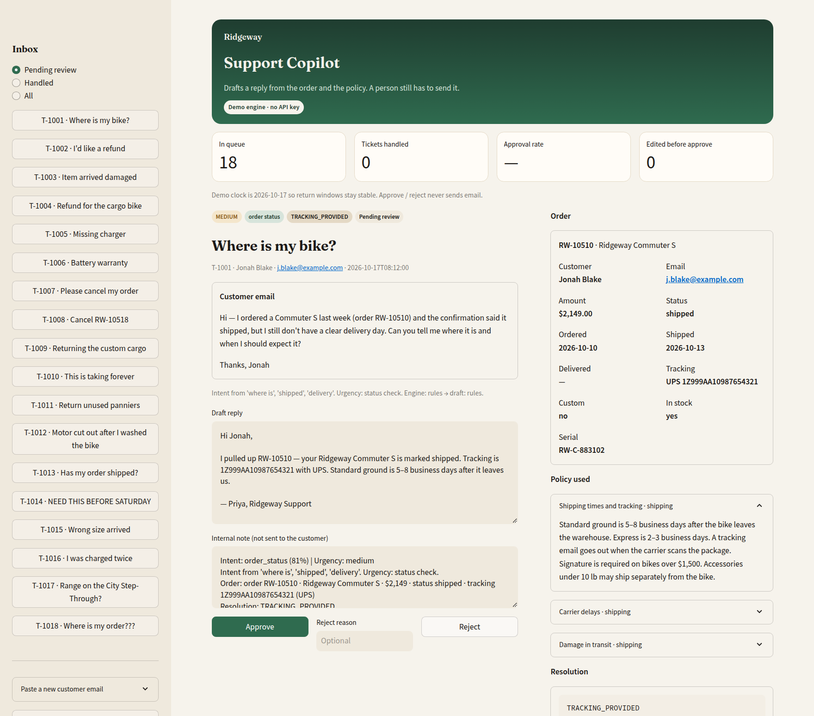
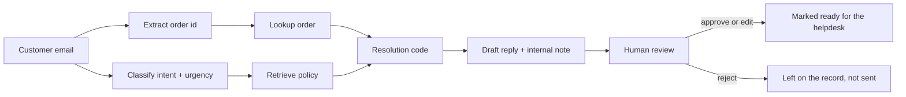

# Ridgeway Support Copilot

A human-in-the-loop copilot that drafts e-commerce support replies from order data and policy — and never sends them.

Built as a portfolio piece by [Stefan Istoc](https://github.com/stefandevelops).



## The business problem

Customer support on a shop like this is mostly the same ten emails: where is my order, I want a refund, the box arrived crushed. Agents already know the policy. What slows them down is bouncing between the helpdesk, Shopify, and a returns doc, then writing the same paragraph again.

Full auto-send is the wrong first step. A bad refund, a denied warranty that should have been approved, or a “we shipped a replacement” that never actually shipped is worse than a slow reply. This app is the step before automation: the model (or a rules engine) does the lookup and the draft, a person approves, edits, or rejects.

## What it does

- Classifies an incoming email (intent + urgency) and pulls the matching order from a mock store plus the relevant return, shipping, or warranty policy.
- Chooses a **resolution code** from policy and order state — refunds and replacements are not left to the language model.
- Drafts a customer reply and an internal note. A human approves, edits, or rejects; nothing is emailed.
- Shows an approval queue and a small metrics panel (tickets handled, approval rate, edits before approve).
- Runs with **no API key** on 18 fake Ridgeway e-bike tickets. If `OPENAI_API_KEY` or `GEMINI_API_KEY` is set, classification and copy can use a real model. The resolution still comes from rules.

## Architecture



Resolution codes stay deterministic on purpose. A model can write the email; it should not invent a $2,149 refund the 30-day window doesn't allow.

## Quickstart

```bash
python -m venv .venv && source .venv/bin/activate
pip install -r requirements.txt
streamlit run app.py
```

Open http://localhost:8501. No API key, no extra setup. Sample tickets are already in the queue.

Optional live model (never required):

```bash
cp .env.example .env   # then set OPENAI_API_KEY or GEMINI_API_KEY
```

`OPENAI_BASE_URL` works with any OpenAI-compatible server. Gemini uses `GEMINI_API_KEY`.

```bash
pytest
```

## How I'd take this to production

- Swap the JSON orders file for Shopify (or whatever OMS) and the ticket inbox for Gorgias / Zendesk / Intercom. Keep the same `ResolutionCode` contract so the UI and metrics don't change.
- Leave the copilot in suggest-only until the team trusts it. Track approval rate and edit distance per intent. The first auto-send candidate is high-confidence WISMO with a live tracking number — not refunds, not warranty, not billing.
- Send the model only the order fields the draft needs (status, dates, tracking, amount), not the whole customer record. Log policy version + order snapshot next to every draft for audit.
- Put an eval set together with the current CS team: 50–100 anonymized tickets they already handled, graded on resolution code first and tone second.
- Critical / legal / injury language, and anything in billing, stays with a person. That is already how this MVP behaves.

## Tech stack

- Python 3.12, Streamlit
- Rule-based classifier, entity extractor, policy retrieval, and resolver
- Optional OpenAI-compatible or Gemini draft/classify via `httpx`
- Pytest + GitHub Actions

All customer names, emails, and orders in `data/` are invented.
